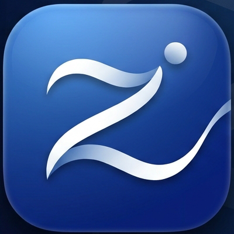
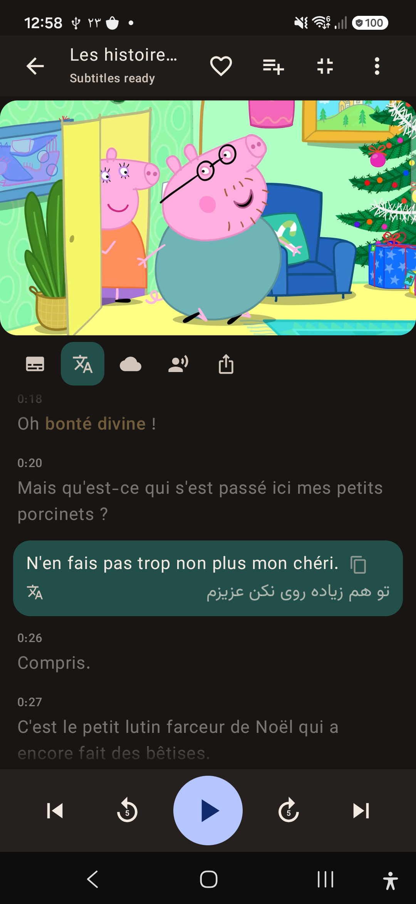
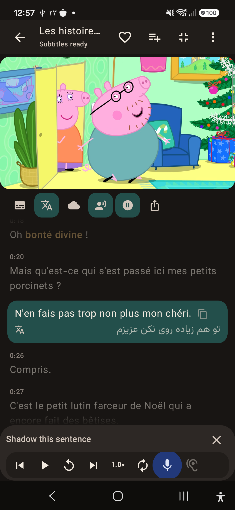
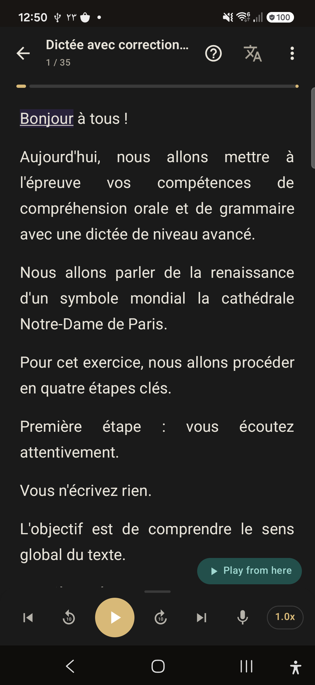
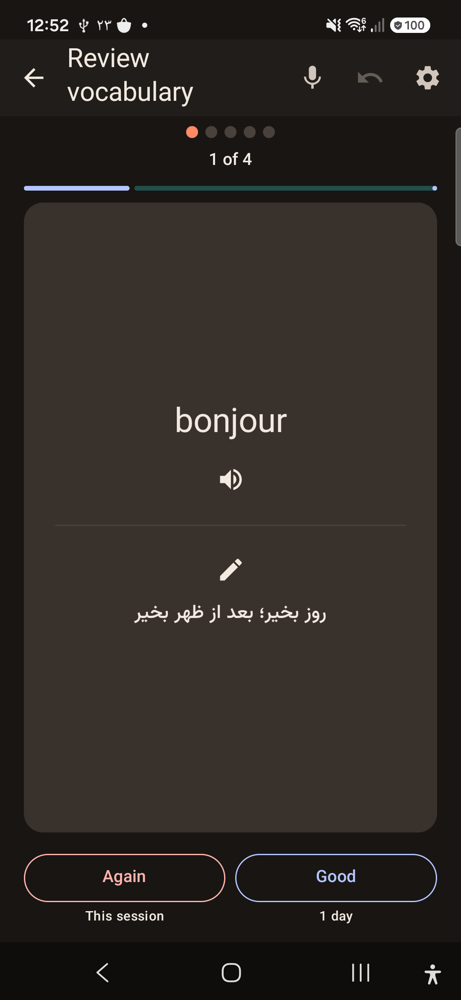
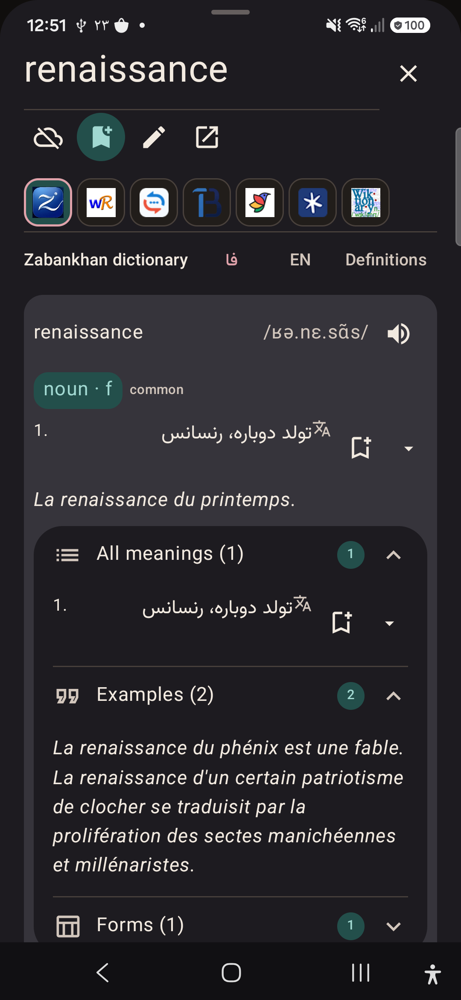

  

<h1 align="center">زبان‌خوان · Zabankhan</h1>

Android · iOS

[English](README.md#english) · [معرفی دوزبانه](README.md)

## فارسی

زبان‌خوان، همراه مطالعه و یادگیری فرانسوی و انگلیسی است؛ متن دلخواهت را بخوان، معنی واژه‌ها را به فارسی یا انگلیسی ببین و آن‌ها را مرور کن.

- **مطالعه با ترجمه و دیکشنری:** لمس واژه برای دیدن معنی، ترجمهٔ جمله و شنیدن تلفظ.
- **کتاب‌ها و فایل‌های خودت:** پشتیبانی از متن، Markdown، EPUB و PDF، همراه با هایلایت و تشخیص متن تصویر (OCR).
- **یادگیری واژه در متن:** ذخیرهٔ واژه‌ها همراه با جمله و مرور فاصله‌دار با جعبهٔ لایتنر.
- **یادگیری با ویدیو و صدا:** یوتیوب و ویدیوی محلی با زیرنویس قابل‌لمس، همراه با تمرین شنیدن و تلفظ.
- **کتابخانهٔ شخصی:** سازمان‌دهی مطالب، واردکردن واژه‌های Anki و CSV و پشتیبان‌گیری از داده‌ها.

[دریافت نسخه‌ها](https://github.com/Ziaeemehr/zabankhan/releases) · [راهنمای ساخت و انتشار](docs/STORE.md) · [حریم خصوصی](PRIVACY.md)

## تصاویر برنامه

تصاویر واقعی نسخهٔ دیباگ روی گوشی سامسونگ.

| پخش ویدیو | تمرین سایه‌گویی |
| :---: | :---: |
|  |  |

| مطالعهٔ متن | مرور واژه‌ها | دیکشنری |
| :---: | :---: | :---: |
|  |  |  |
