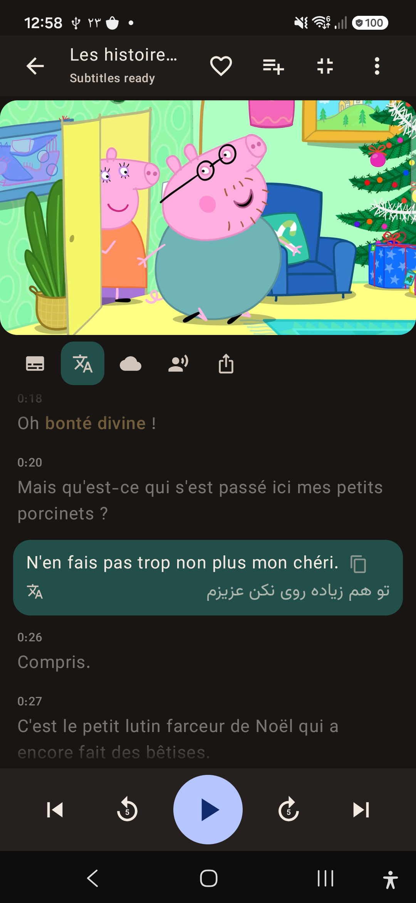
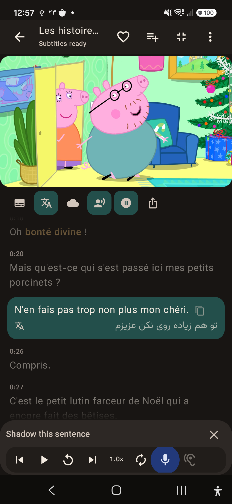
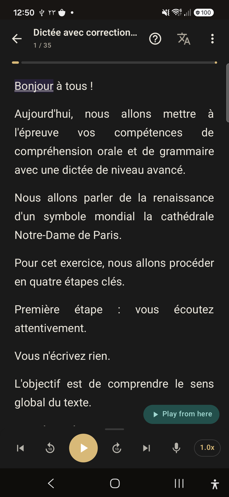
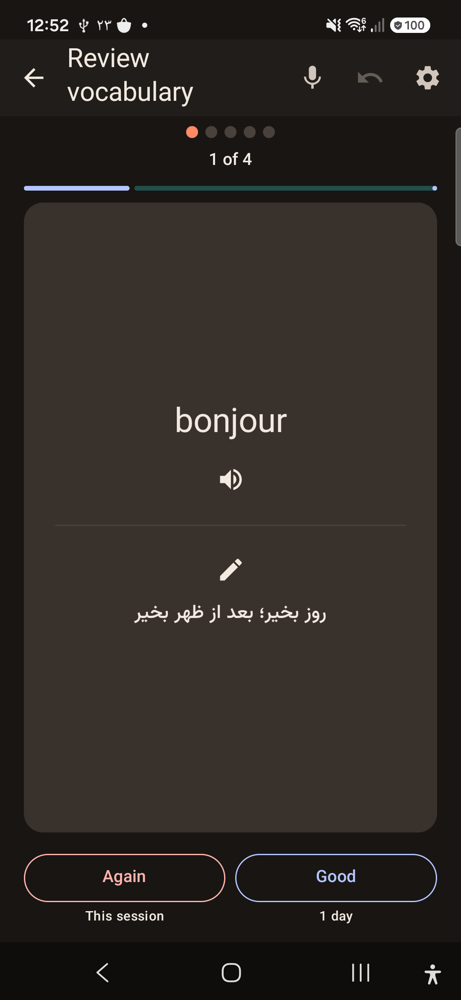
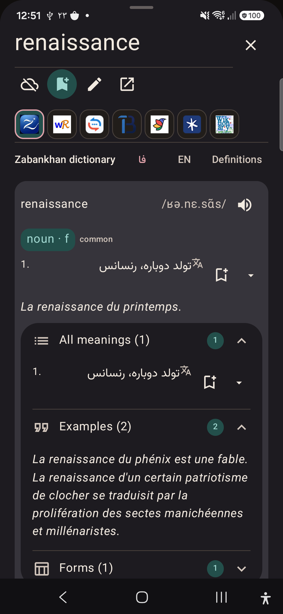

  

<h1 align="center">زبان‌خوان · Zabankhan</h1>

Android · iOS

[فارسی](#فارسی) · [English](#english)

## فارسی

زبان‌خوان، همراه مطالعه و یادگیری فرانسوی و انگلیسی است؛ متن دلخواهت را بخوان، معنی واژه‌ها را به فارسی یا انگلیسی ببین و آن‌ها را مرور کن.

- **مطالعه با ترجمه و دیکشنری:** لمس واژه برای دیدن معنی، ترجمهٔ جمله و شنیدن تلفظ.
- **کتاب‌ها و فایل‌های خودت:** پشتیبانی از متن، Markdown، EPUB و PDF، همراه با هایلایت و تشخیص متن تصویر (OCR).
- **یادگیری واژه در متن:** ذخیرهٔ واژه‌ها همراه با جمله و مرور فاصله‌دار با جعبهٔ لایتنر.
- **یادگیری با ویدیو و صدا:** یوتیوب و ویدیوی محلی با زیرنویس قابل‌لمس، همراه با تمرین شنیدن و تلفظ.
- **کتابخانهٔ شخصی:** سازمان‌دهی مطالب، واردکردن واژه‌های Anki و CSV و پشتیبان‌گیری از داده‌ها.

[دریافت نسخه‌ها](https://github.com/Ziaeemehr/zabankhan/releases) · [راهنمای ساخت و انتشار](docs/STORE.md) · [حریم خصوصی](PRIVACY.md)

## English

Zabankhan helps you learn French and English through reading. Bring your own texts, look up words with Persian or English meanings, and review what you learn.

- **Read with translation and dictionaries:** tap a word for its meaning, translate sentences, and listen to pronunciation.
- **Bring your own books and files:** read text, Markdown, EPUB, and PDF with highlights and image text recognition (OCR).
- **Learn words in context:** save vocabulary with example sentences and review it with Leitner spaced repetition.
- **Learn with video and audio:** watch YouTube or local videos with tappable subtitles and practice listening and pronunciation.
- **Keep a personal library:** organize reading material, import Anki and CSV vocabulary, and back up your data.

[Releases](https://github.com/Ziaeemehr/zabankhan/releases) · [Build & release guide](docs/STORE.md) · [Privacy](PRIVACY.md)

## تصاویر برنامه · Screenshots

تصاویر واقعی نسخهٔ دیباگ روی گوشی سامسونگ · Captured from the debug app on a Samsung phone.

| پخش ویدیو · Video playback | تمرین سایه‌گویی · Shadowing |
| :---: | :---: |
|  |  |

| مطالعهٔ متن · Reading | مرور واژه‌ها · Vocabulary review | دیکشنری · Dictionary |
| :---: | :---: | :---: |
|  |  |  |
